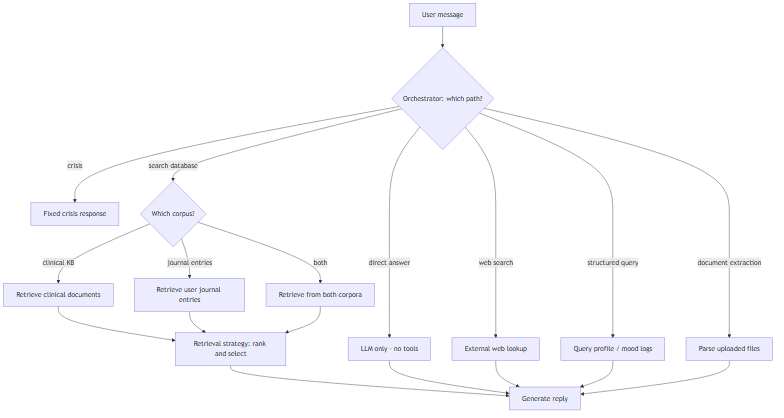

# Agentic RAG System: Testing & Strategy Map

*A planning overview for managers and partners — what we're building, what can be tested, and what's left.*

---

## Executive summary

Copefy's chat agent makes several layered decisions on every user message: which tool or capability to use, whether to search stored data, what to search (clinical content vs the user's own journal entries), how to retrieve and rank results, and how to generate a response. Each layer has different strategy options and different testing needs.

Orchestration is now a **single decision** with two interchangeable implementations (rule-based and AI-driven) scored against a 303-case labeled suite. Retrieval over the **clinical knowledge base** is built with four comparable strategies. The remaining gaps are **corpus selection** (journal entries are not searchable yet), the three placeholder tools, and **response quality** — we can measure whether the agent took the right path and found the right documents, but not yet whether the final answer is good.

---

## Data sources (important context)

All searchable content lives in our database. There are two distinct corpora:

| Corpus | What it contains | Example use case |
|--------|-----------------|------------------|
| **Clinical knowledge base** | Curated medical and coping documents (articles, guides, strategies) | User shares ADHD symptoms → retrieve relevant coping strategies |
| **User journal entries** | The user's own past journal posts, stored per user | User says "I'm feeling anxious again" → retrieve when they last felt anxious and how they described it; user mentions an upcoming exam → retrieve how they've written about exams before, their tone, recurring patterns |

**How they differ:** The clinical KB provides general knowledge (what might help). Journal entries provide **personal context** about this specific user — their history, emotional patterns, recurring situations, and how they tend to talk about things. Users won't usually ask "how did I feel last week?" directly; instead, the agent proactively pulls relevant journal context to make responses more personalized and grounded in the user's own experience.

Both are retrieved via semantic search over embedded content in the database. Journal search is **not** a separate external tool — it is part of database/KB retrieval, targeting a different corpus. The orchestrator decides whether to search, and which corpus(es) to search.

---

## How the layers relate

The orchestrator makes a single top-level decision on each message. If it chooses **search database**, corpus selection and retrieval strategy follow — there is no second "search or skip" step.



| Layer | Question it answers | Status |
|-------|--------------------|--------|
| **1. Agent orchestration** | Which path? (crisis, direct answer, search database, web search, structured query, document extraction) | Unified and measured — every message goes through one router; crisis, direct answer, and clinical KB search execute for real, the other three paths route correctly but their backends are stubs |
| **2. Corpus selection** | If search database → clinical KB, journal entries, or both? | Not built — clinical KB is the only searchable corpus |
| **3. Retrieval strategy** | How do we find and rank the best content? | Built for clinical KB — 4 strategies ready to compare |
| **4. Generation** | How do we craft the prompt and produce the reply? | Built, not yet evaluated |
| **5. End-to-end quality** | Is the final answer empathetic, safe, relevant, and grounded? | Not built |

### The golden test suite

Labeled cases live in `backend/eval/golden/`. Everything except `templates.yaml` is scored. After consolidation there are **five case files** (plus templates):

| File | Role | Tuned against? |
|------|------|----------------|
| `core.yaml` | Everyday coverage — hand seeds + template-generated cases | Yes (regression) |
| `safety.yaml` | Crisis positives + `crisis_trap` / `web_trap` negatives | Yes |
| `tools.yaml` | Web / structured / document positives + `tool_trap` negatives | Yes |
| `edges.yaml` | Hard phrasing — behavioral symptoms, typos/slang, multi-turn | Yes |
| `heldout_counseling.yaml` | External counseling questions (HuggingFace), independent labels | **No** — measure only |
| `templates.yaml` | Generators for the `gen_*` half of `core.yaml` | N/A |

Regression size is **529** cases (`--exclude-tag heldout`). Held-out adds **831** more (all unique questions in the HF counseling set).

**Why negative cases matter.** A path can score perfect recall by over-firing. For crisis that replaces the conversation with a hotline message. Tags `crisis_trap` / `web_trap` / `tool_trap` are enforced by `validate_golden`.

```bash
python -m eval.validate_golden
python -m eval.layer1_eval --router rule --exclude-tag heldout   # regression
python -m eval.layer1_eval --router rule --tag heldout --no-gate # generalization
python -m eval.generate_golden   # refresh gen_* rows inside core.yaml
```

**Known weaknesses:** template cases overweight search-vs-direct; document cases are easy giveaways; crisis positives were co-written with patterns (traps are the honest half).

**Note on "direct answer vs search database":** not a separate layer — two of the six Layer 1 branches, decided in `agent/routers/`.

---

## Layer 1: Agent Orchestration

**What it controls:** The macro routing decision — which tool or capability the agent uses before generating a reply.

### Available tools

| Tool | What it does | Status |
|------|-------------|--------|
| **Crisis response** | Immediately return a fixed crisis message (988, emergency services) — no AI generation | Built |
| **Direct answer** | Respond using only the language model, no tools or retrieval | Built |
| **Database / KB search** | Semantic search over stored content — clinical documents today, journal entries later | Built for clinical KB |
| **Web search** | Look up external factual information from the internet | Routing built; backend is a stub |
| **Structured data query** | Query user profile, mood logs, or other tabular data | Routing built; backend is a stub |
| **Document extraction** | Parse and use content from uploaded documents | Routing built; backend is a stub |

Web search is deliberately treated as a **last resort**. A therapy companion should never send someone's personal disclosure to an external search engine, so the router only takes that path for external facts the model plausibly lacks, and never for anything the user says about themselves.

### Orchestration strategy options

Both routers implement the same interface and are selected with the `AGENT_ROUTER` setting, so they can be swapped without touching the orchestrator.

| Strategy | Description | Status |
|----------|-------------|--------|
| **Rule-based router** | Pattern matching over crisis language, document references, personal-data questions, explicit lookups, venting, and clinical content | Built — current default |
| **AI-driven router** | The model picks one of the six paths under a routing instruction that encodes the same preferences | Built |
| **Multi-step agent loop** | Chain multiple paths (e.g. search journal → search clinical KB → answer) | Deferred until single-pass routing is settled |

### Routing signals in the rule-based router

- **Crisis:** explicit keywords plus indirect phrasing (passive ideation, plan and means, goodbye notes, giving possessions away, feeling like a burden), checked against the current message and the last two user turns
- **Document extraction:** references to an uploaded, attached, or shared file
- **Structured query:** questions about the user's own logged data — mood scores, journal counts, streaks, profile
- **Web search:** explicit lookup verbs, or weaker external-fact cues when the message has no clinical content
- **Direct answer:** empty messages, venting language, bare mood check-ins, short replies to an assistant question
- **Search database:** clinical content detected in the message or recent conversation, with the query enriched by category-specific terms

### How to test

`python -m eval.layer1_eval --router rule` scores any router against the golden suite. `--router all` runs the bake-off and prints a comparison table.

| Test | What it measures | Target |
|------|-----------------|--------|
| **Crisis recall** | Every crisis message gets the crisis response, never AI generation | 100% — the script exits non-zero below this |
| **Crisis over-fires** | Ordinary talk ("ending it with my boyfriend") must not trigger a hotline reply | 0 of the 14 `crisis_trap` cases — hard exit condition |
| **Web false positives** | Personal messages that look like lookups must not go outward | 0 of the 34 `web_trap` cases — hard exit condition |
| **Per-path precision and recall** | Whether each path fires when it should and only when it should | Reported per path; the case mix is deliberately lopsided, so overall accuracy is the least useful number |
| **Per-type accuracy** | Accuracy by message type (venting, symptom sharing, coping request, etc.) | Venting and vague check-ins must never trigger retrieval |
| **Latency by router** | Cost of AI routing versus pattern matching | Reported per case |

### Measured results

Rule-based router over all 529 cases:

| Metric | Result |
|--------|--------|
| Overall accuracy | 100% (529/529) |
| Crisis recall | 100% (63/63) |
| Crisis over-fires | 0 / 37 traps |
| Web false positives | 0 / 39 traps |
| Per-path recall | all six paths 100% |
| Latency | ~0.3 ms per message |

Ship decision: keep `AGENT_ROUTER=rule`. Routing is free and fast; spend model budget on generating the reply, not choosing the path. Re-run `python -m eval.layer1_eval --router rule --exclude-tag heldout` whenever patterns or golden cases change.

### Held-out check (generalization)

The HuggingFace counseling corpus has **831 unique questions** after dedupe (requested 1000). They are labeled independently (`heldout_counseling.yaml`). Clinical vocabulary was expanded **once** from failure *themes* (abuse/trauma, grief, loneliness, “how do I handle…”), not by chasing case IDs. Do not retune against this file.

| Suite | Cases | Rule accuracy | Crisis recall |
|-------|-------|---------------|---------------|
| Regression (ours) | 529 | 100% | 100% |
| Held-out counseling | 831 | **64.1%** | 95.8% |

The drop from the old 200-case 75.5% is mix, not a router regression: the extra rows are mostly long relationship/life posts with no clinical vocabulary. One crisis label on the larger set is missed. Do not add keywords to chase this file.

```bash
python -m eval.import_counseling_heldout --n 1000
python -m eval.layer1_eval --router rule --tag heldout --no-gate
```

### Next layers

Layer 1 is complete — see `docs/LAYER1_HANDOFF.md` for a short onboarding note.

| Layer | Focus |
|-------|--------|
| **2 — Corpus selection** | Clinical KB vs journal vs both once journal retrieval exists (`expected_corpus` already on search cases) |
| **3 — Retrieval strategies** | Compare clinical retrieval strategies with `run_strategy_compare` |

The 12 remaining failures are almost all one shape: someone describing a symptom in plain language with no clinical vocabulary to match on ("I keep forgetting to take my medication", "I cancel plans at the last minute"). That is the intrinsic ceiling of keyword matching and the main thing the AI router is expected to beat.

The AI router is verified working (100% on a crisis slice) but has **not** been scored on the full suite, because free-tier `generateContent` quotas make it impractical:

| Model | Free-tier limit | Usable for a 303-case run? |
|-------|-----------------|----------------------------|
| `gemini-3.6-flash` | 20 requests **per day** | No — a hard ceiling, not a pacing problem |
| `gemini-3.1-flash-lite` | 15 requests **per minute**, no daily cap | Only slowly — roughly 45 minutes per run |

The fix is a billing-enabled key in `AGENT_ROUTER_API_KEY`, which the router reads in preference to `GEMINI_API_KEY`. That keeps chat and embeddings on their existing key while routing bills to a paid project, and takes a full run from ~45 minutes to under a minute. Until then the rule-based router stays the default.

### What needs to be built

- Score the AI router on the full suite and pick a production default
- Real backends for web search, structured query, and document extraction
- Wire `layer1_eval` into an automated regression check

---

## Layer 2: Corpus selection

**What it controls:** Once Layer 1 chooses **search database**, which corpus to search.

| Corpus target | When to use | Status |
|---------------|------------|--------|
| **Clinical KB only** | User shares symptoms, asks for coping strategies, needs clinical grounding | Built — currently the only option |
| **Journal entries only** | User shares something personal where their own history adds context (recurring anxiety, exams, relationships) — even without explicitly referencing their journal | Not built |
| **Both** | Message benefits from general clinical knowledge AND personalized context from the user's past writing | Not built |

The golden schema already carries an `expected_corpus` field so this layer becomes measurable the moment journal retrieval exists; today every search case is labeled `clinical`.

### How to test

| Test | Metric | Target |
|------|--------|--------|
| **Corpus selection accuracy** | Correct corpus targeted (clinical, journal, both) | Not yet testable — needs journal retrieval and journal-labeled cases |
| **Privacy isolation** | Journal search only ever returns the requesting user's entries | Hard requirement once built |

### What needs to be built

- Journal entry embeddings and search
- Corpus selection logic in the router, plus labeled cases for journal and both
- Extend `layer1_eval` to score `expected_corpus` alongside `expected_path`

---

## Layer 3: Retrieval Strategies (how to retrieve)

**What it controls:** Given the decision to search, how to find, rank, filter, and select the best content. Applies to whichever corpus is being searched.

### Strategy options (built for clinical KB, ready to compare)

| Strategy | Approach | Key difference |
|----------|----------|----------------|
| **Baseline** | Standard search width with heuristic reranking | Comparable runner-up |
| **Similarity threshold** | Drop results below a confidence cutoff (0.65) | No-op on current KB (identical to baseline) |
| **MMR (diversity)** | Balance relevance against redundancy | **Production default** |
| **Wide-then-narrow** | Search a larger pool, then narrow to best results | Slightly worse category recall |

All strategies share the same pipeline: detect clinical categories → embed the query → vector search (category-filtered, with fallback) → rerank → optionally filter → return top chunks for the prompt.

The same strategy framework should extend to journal entry retrieval once that corpus is searchable.

### Sub-decisions within retrieval (not yet independently testable)

| Sub-decision | Current approach | Configurable? |
|--------------|-----------------|---------------|
| Clinical category detection | Keyword matching on 5 categories | Fixed |
| Query expansion | Per-category clinical term enrichment | Fixed |
| Search breadth | 20 or 40 candidate chunks | Per strategy |
| Reranking method | Heuristic vs diversity-aware (MMR) | Per strategy |
| Chunks sent to the model | Top 3 | Fixed |
| Embedding model | Gemini embedding model | Configurable |

### How to test

| Test | What it measures |
|------|-----------------|
| **Category recall** | Do retrieved clinical chunks match the expected categories? |
| **Journal recall** | Do retrieved journal entries surface relevant personal context (patterns, past episodes, tone)? (not yet testable) |
| **Empty retrieval rate** | How often does search return zero useful results? |
| **Strategy bake-off** | Head-to-head comparison of all 4 strategies on recall, confidence, and speed |
| **Per-scenario breakdown** | Which strategies work best for which message types? |

**Existing test infrastructure:** Automated retrieval evaluation and a strategy comparison tool that exports results for analysis (clinical KB only).

### What's still missing

- Journal entry retrieval and evaluation
- Finer-grained relevance metrics (ranked relevance scoring, not just category match)
- Human or AI labels on whether individual chunks actually help answer the question
- Independent testing of sub-decisions (category detection, query expansion, chunk count)

---

## Layer 4: Generation & Prompting

**What it controls:** How retrieved content and tool results are formatted, and how the language model produces the final reply.

### Strategy options to explore

| Area | Current approach | Options to test |
|------|-----------------|-----------------|
| **System instructions** | Single companion-style prompt for all messages | Per-intent variants; stricter grounding vs more conversational |
| **Context injection** | Background reference block with top 3 chunks | Vary chunk count (0, 1, 3, 5); require citations vs silent grounding; separate formatting for clinical vs journal content |
| **Conversation history** | Last 6 turns included | Shorter (2–4) vs longer (8–12) context windows |
| **Anti-repetition** | Hints to avoid repeating the last reply | On/off comparison |
| **Model selection** | Fast model with fallback | Fast vs more capable model comparison |
| **Generation settings** | Default temperature and config | Lower temperature for consistency |

### How to test

| Test | Status | Approach |
|------|--------|----------|
| Manual QA via debug trace | Available | Layer timeline (L1–L4) under each reply when `VITE_RAG_DEBUG=true` |
| Persona from profile | Built | Four preset styles + custom text from Settings |
| Terminal pipeline logs | Built | `[pipeline]` lines when `RAG_DEBUG=true` |
| Prompt consistency | Built (offline) | `tests/test_persona_prompt.py` |
| Response quality | Not built | See Layer 5 |
| Groundedness | Not built | Does the response align with retrieved sources? |
| Safety compliance | Not built | No diagnosis, no medical advice, crisis handled correctly |
| Repetition detection | Not built | Compare consecutive replies for overlap |

---

## Layer 5: End-to-End Response Evaluation

**What it controls:** Whether the final answer is actually good. This is the layer with the largest gap — we can test retrieval quality today, but not answer quality.

### Evaluation strategy options

| Strategy | What it measures | Status |
|----------|-----------------|--------|
| **Routing and retrieval metrics** | Per-path precision and recall, category recall, strategy comparison | Built (clinical KB) |
| **Rule-based checks** | Crisis keywords present, response length, banned phrases | Not built |
| **AI-as-judge** | Score responses on a rubric (empathy, relevance, safety, grounding) | Not built |
| **Pairwise comparison** | Two strategies answer the same question; judge picks the better one | Not built |
| **Human evaluation** | Annotators score responses on defined criteria | Not built |
| **Reference answer matching** | Compare generated response to an expected ideal answer | Not built |

### Proposed scoring dimensions (AI-as-judge)

For a mental health companion, score each response 1–5 on:

1. **Empathy** — warm, non-judgmental tone
2. **Relevance** — addresses what the user actually said
3. **Safety** — no diagnosis, no medical advice, crisis handled correctly
4. **Grounding** — aligns with retrieved sources when used; no fabricated clinical facts when not
5. **Brevity** — respects the concise response guideline
6. **Non-repetition** — doesn't parrot the user or repeat a prior assistant message

### How to test (proposed)

Run the full agent pipeline on labeled test cases → score the generated response → check that the right tools were used and the right corpora were searched → aggregate scores per strategy configuration.

**Test case extensions needed:**
- Expected ideal responses or scoring rubrics
- Expected intent, expected tool usage, and expected corpus per case
- Must-contain / must-not-contain rules for safety checks

---

## Layer 6: Tools summary

All tools the orchestrator can invoke, with their role in the system:

| Tool | Type | What it searches / does | Status |
|------|------|------------------------|--------|
| **Database search — clinical KB** | Internal retrieval | Curated medical and coping documents | Built |
| **Database search — journal entries** | Internal retrieval | Personal context from user's past writing (patterns, history, tone) | Placeholder (data stored, embeddings not yet searchable) |
| **Web search** | External tool | Internet factual lookup | Routed correctly; backend is a stub |
| **Structured data query** | Internal tool | User profile, mood logs, tabular data | Routed correctly; backend is a stub |
| **Document extraction** | Internal tool | Parse uploaded files | Routed correctly; backend is a stub |
| **Direct answer** | No tool | Language model only | Built |
| **Crisis response** | No tool | Fixed safety message | Built |

**Cross-cutting concerns for all tools:** response latency, error handling, graceful degradation when a tool is unavailable, privacy isolation (journal entries must only return the requesting user's data).

---

## Layer 7: Infrastructure & Observability

| Area | Status | What's needed |
|------|--------|---------------|
| **Debug trace panel** | Built | Shows path, router, reason, tools, and sources; still needs strategy name and per-step timing |
| **Automated regression checks** | Not built | Run `validate_golden` and `layer1_eval` automatically when code changes |
| **Unit test coverage** | Not built | Automated tests for routing and ranking logic |

---

## Recommended work order

1. ~~**Consolidate orchestration and gating**~~ — done: one router interface, one decision per message
2. ~~**Lock down routing accuracy**~~ — done: 303-case suite, 96% overall, crisis and web-safety gates enforced
3. **Score the AI router on the full suite** — blocked on a billing-enabled API key; run the bake-off and pick a production default once available
4. ~~**Pick a clinical retrieval strategy**~~ — done: `RAG_STRATEGY=mmr` (regression recall 0.948 after fixing mislabeled `gen_*` rows; 0.919 before). See `docs/LAYER3_HANDOFF.md`.
5. **Implement journal entry retrieval** — embed journal entries, extend database search to both corpora, add corpus selection cases
6. **Build response evaluation** — AI-as-judge on core test cases; expand suite with expected behaviors
7. **Activate external tools** — real backends for web search, structured query, document extraction
8. **Revisit multi-step loops** — only once single-pass routing is settled

---

## Quick reference: what exists vs what's left

| Area | Built | Tested | Remaining work |
|------|-------|--------|----------------|
| Path routing (all six paths) | Yes, unified | Automated (303 cases) | Score the AI router, wire eval into the dev pipeline |
| Crisis handling | Yes | Automated, 100% recall | Keep the case set growing as new phrasings appear |
| Rule vs AI router comparison | Both built | Rule scored; AI smoke-tested | Full AI run, then choose a default |
| Corpus selection (clinical vs journal) | No | Not testable | Implement journal retrieval, add labels |
| Retrieval strategies — clinical KB (4 options) | Yes | Automated bake-off | Winner: `mmr`. Finer relevance metrics still later |
| Retrieval strategies — journal entries | No | — | Build and evaluate |
| Generation / prompting | Yes (persona-aware) | Offline prompt tests + manual trace | Layer 5 answer judge still open |
| Response quality evaluation | No | — | AI-as-judge, safety checks |
| Web search / structured query / doc extraction | Routing only | Routing tested | Build the backends |
| Multi-step agent loop | No | — | Design after single-pass is measured |
| Automated eval on code changes | No | — | Wire evaluation into development pipeline |
